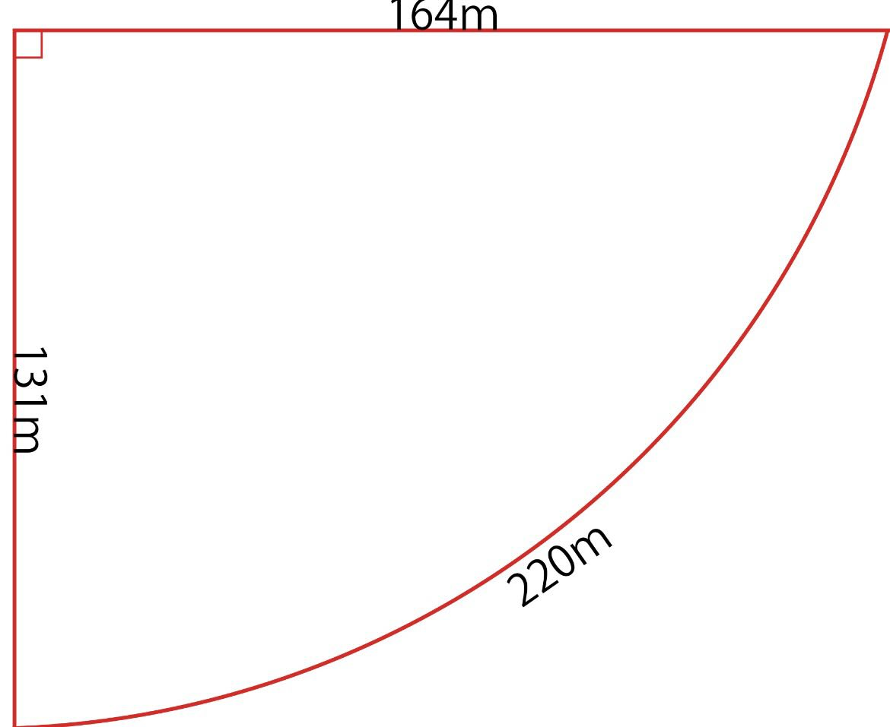
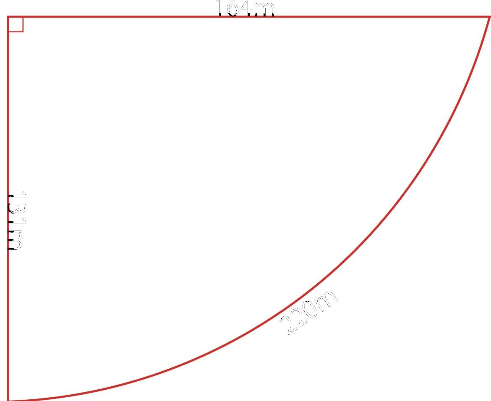

# red-boundary-area-calculator

赤線で囲まれた部分の面積計算

このリポジトリは、画像内の赤線で囲まれた部分のピクセル数を測定し、実寸の長さから面積を計算するためのスクリプトをまとめたものです。

## 図

### 元画像



### 黒い寸法文字を取り除いた画像



## 測定値

今回の計算では、次の値を使います。

| 項目 | 値 |
| --- | ---: |
| 左側の赤線の実寸 | 131 m |
| 左側の赤線の高さ | 926 px |
| 赤線で囲まれた部分のピクセル数 | 732,466 px |

## 数式

左側の赤線が 131 m で、画像上では 926 px なので、1ピクセルあたりの長さは次のように求めます。

```text
1 px あたりの長さ = 131 / 926
                 = 約 0.14147 m/px
```

1ピクセルあたりの面積は、長さを2乗して求めます。

```text
1 px あたりの面積 = (131 / 926)^2
                 = 約 0.02001 m²/px
```

赤線で囲まれた部分は 732,466 px なので、面積は次のように求めます。

```text
面積 = 732,466 × (131 / 926)^2
     = 732,466 × 約 0.02001
     = 約 14,655.6 m²
```

## 計算結果

赤線で囲まれた部分の面積は、約 **14,656 m²** です。

## 使い方

依存パッケージは [uv](https://docs.astral.sh/uv/) で管理しています。

黒い寸法文字や寸法線を取り除く場合は、次のコマンドを実行します。

```bash
uv run remove_black.py right-angle-curved-boundary-layout-164m-131m-220m.jpg output.jpg
```

赤線で囲まれた部分のピクセル数を求める場合は、次のコマンドを実行します。

```bash
uv run count_enclosed_pixels.py
```

左側の赤線の高さを求める場合は、次のコマンドを実行します。

```bash
uv run left_red_height.py
```
